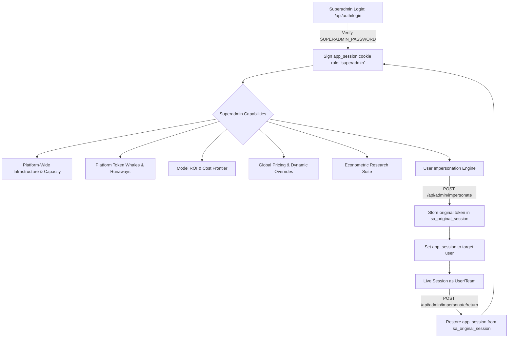
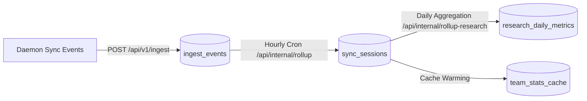

# Token Tracer — Superadmin Architectural & Functional Report

## Executive Summary

The **Superadmin Portal** (`/admin` and `/admin/research`) serves as the central intelligence, governance, econometrics, and infrastructure management system for Token Tracer. It is designed for multi-tenant oversight, real-time developer token accounting, prompt caching ROI analysis, runaway loop detection, and AI behavioral research across engineering teams.

---

## 1. Security & Identity Architecture



### Access Control & Session Verification
- **Stateless HMAC-SHA256 Token**: Authenticated against `SUPERADMIN_PASSWORD` (using timing-safe SHA-256 byte comparison) and signed with `SESSION_SECRET` into an HTTP-only, `SameSite=Lax` cookie (`app_session`).
- **Unrestricted Multi-Tenant Scope**: Unlike team members or team admins who are bound to their specific `team_id`, superadmin requests bypass tenant isolation filters by default unless a `?teamId=<UUID>` filter is explicitly supplied.
- **Zero-Knowledge Key Storage**: Developer API keys are hashed with SHA-256 upon generation. Only the `key_hash` is retained in `member_keys`; raw keys are never stored in the database.

### Impersonation Subsystem (`/api/admin/impersonate` & `/api/admin/impersonate/return`)
- **Stateless Cookie Swap**:
  1. The active superadmin session token is serialized into the backup cookie `sa_original_session`.
  2. The primary `app_session` cookie is overwritten with the target user's identity, enriched with `impersonatedBy: superadmin_user_id`.
- **Anti-Nesting Guard**: Rejects nested impersonation requests if `session.impersonatedBy` or `sa_original_session` is already present.
- **Persistent Return Banner**: Injected across all dashboard layouts via `/impersonation.js`, displaying the active target user and providing an instant "Return to Superadmin" action.
- **Audit Logging**: Every impersonation action is logged in `audit_logs` (`impersonate.start` and `impersonate.stop`) with actor, target, and timestamp.

---

## 2. Core Superadmin Dashboard Systems (`/admin`)

The primary superadmin dashboard ([`components/admin/SuperadminDashboardView.tsx`](components/admin/SuperadminDashboardView.tsx)) consolidates six operational subsystems:

```
┌─────────────────────────────────────────────────────────────────────────────────────────┐
│                               SUPERADMIN CONTROL PORTAL                                 │
├──────────────────────────┬───────────────────────────┬──────────────────────────────────┤
│ 1. INFRASTRUCTURE HEALTH │ 2. PLATFORM TOKEN WHALES  │ 3. MODEL ROI FRONTIER            │
│  - Neon 500MB DB Limit   │  - Top consuming users    │  - Cost per 100 Net Lines        │
│  - Vercel 100k Invocs    │  - Runaway sessions (>1M) │  - Prompt Cache Savings ($)      │
│  - Buffer Cache Hit Rate │  - 6D Member Deep-Dive    │  - Token Density vs Verbosity    │
├──────────────────────────┼───────────────────────────┼──────────────────────────────────┤
│ 4. GLOBAL PRICING RULES  │ 5. USER & TEAM DIRECTORY  │ 6. AUDIT LOG & COMPLIANCE        │
│  - Baseline vs Overrides │  - Account lockouts/resets│  - Actor & timestamp logging     │
│  - Batch Cost Recalc     │  - Role elevations        │  - Destructive action tracking   │
└──────────────────────────┴───────────────────────────┴──────────────────────────────────┘
```

---

### A. Infrastructure & Capacity Monitoring (`/api/admin/infra-health`)
Tracks free-tier limits, hardware utilization, and sync pipelines:
- **Database Compute & Storage**: Queries `pg_database_size(current_database())` against the Neon 500MB storage ceiling.
- **Table Storage Breakdown**: Details `pg_total_relation_size`, table data size, index size, and estimated live tuples for the top 15 database tables.
- **Buffer Cache Hit Ratio**: Inspects `pg_statio_user_tables` to measure disk I/O efficiency (flagged if $<95\%$).
- **Vercel Serverless Invocation Estimator**: Computes daily ingestion batches and estimated API requests against the 100,000 requests/day free tier.
- **24-Hour Ingestion Traffic Leveling**: Hourly histogram of sync batches to detect traffic spikes.
- **Daemon Migration Progress**: Live distribution of active client daemon versions (tracking percentage migrated to `v1.3.0`+).
- **Retention & Data Hygiene**: Monitors raw event batches older than 7 days pending vacuuming/pruning.

---

### B. Platform Token Whales & Runaways (`/api/admin/top-usage`)
- **Platform-Wide Whale Leaderboard**: Ranks all developers across all organizations by total token consumption (Input + Output + Cache).
- **Runaway Loop Detection**: Flags infinite loops or runaway agent sessions (e.g. $>1,000,000$ tokens or $>50$ turns without net code additions).
- **6-Dimensional Developer Deep-Dive**: Clicking any developer opens a multi-dimensional diagnostic modal:
  1. *Model Distribution* (Claude 3.7 Sonnet, Claude 3.5 Haiku, GPT-4o, o3-mini, DeepSeek)
  2. *Tool Usage* (`edit_file`, `bash`, `notebookedit`, `read_file`, `grep`)
  3. *Error & Correction Friction* (Syntax mistakes, command retries, prompt corrections)
  4. *Project Cost Allocation*
  5. *Token Velocity over Time*
  6. *Prompt Length vs Code Yield*

---

### C. Model ROI & Efficiency Frontier (`/api/admin/model-roi`)
Quantifies developer output per dollar spent across models:
- **Cost per 100 Net-Accepted Lines**: Evaluates:
  $$\text{CostPer100} = \frac{\text{Total Cost}}{\text{Effective Lines Changed}} \times 100$$
- **Prompt Caching Financial Savings**: Calculates cash saved via prompt caching:
  - Anthropic: $90\%$ discount on cache reads ($\$0.30/\text{M}$ vs $\$3.00/\text{M}$).
  - OpenAI: $50\%$ discount on cache reads ($\$1.25/\text{M}$ vs $\$2.50/\text{M}$).
- **Output Verbosity vs Code Yield**: Measures tokens generated per line of accepted code:
  - *High Density (Optimal)*: $<25$ tokens/line.
  - *Moderate Density*: $25–55$ tokens/line.
  - *Heavy Reasoning*: $>55$ tokens/line.
- **Tool Error Rates**: Tracks hallucination and syntax failure rates per model.

---

### D. Global Model Pricing Engine (`/api/admin/pricing` & `/api/admin/pricing/sync`)
- Combines default baseline reference pricing ([`lib/pricing.json`](lib/pricing.json)) with PostgreSQL overrides in `model_pricing`.
- Configurable per-million token rates for:
  - Input Prompt Tokens ($I$)
  - Output Completion Tokens ($O$)
  - Prompt Cache Reads ($C_r$)
- **Automated Cost Recalculation**: Updating or deleting a pricing rule triggers `recalculateTeamCosts` across all historical sessions.

---

### E. User & Team Directory (`/api/admin/users`, `/api/admin/teams`)
- Multi-tenant directory displaying all accounts across all teams.
- **Security Actions**: Clear account lockout (frozen after 5 failed password attempts), issue temporary passwords, modify account active status, and elevate/demote roles (`user` $\leftrightarrow$ `admin` $\leftrightarrow$ `superadmin`).

---

### F. Security Audit Trail (`/api/admin/audit-log`)
- Immutable log of administrative operations in `audit_logs`.
- Records: Actor user ID, actor username, action type (`impersonate.start`, `impersonate.stop`, `user.lock`, `user.reset_password`, `pricing.create`, `pricing.update`, `pricing.delete`), target entity, and contextual metadata.

---

## 3. The AI Behavioral & Econometric Research Suite (`/admin/research`)

The research suite provides seven empirical studies built from real developer agent telemetry:

```
┌────────────────────────────────────────────────────────────────────────────────────────┐
│                        AI BEHAVIORAL RESEARCH & ECONOMETRICS                           │
├────────────────────────────────────────┬───────────────────────────────────────────────┤
│ 1. Error Spikes & Anomaly Detection    │ Daily tool-error trend with rolling 7-day     │
│    (/admin/research/error-spikes)      │ baseline anomaly detection (σ > 2.5).         │
├────────────────────────────────────────┼───────────────────────────────────────────────┤
│ 2. Context Saturation Thresholds       │ Context window fill % degradation curves      │
│    (/admin/research/context-saturation)│ where tool error rates begin compounding.     │
├────────────────────────────────────────┼───────────────────────────────────────────────┤
│ 3. Prompt Specificity Index            │ Code revert and rework rates for structured   │
│    (/admin/research/prompt-specificity)│ prompts (diffs, tracebacks) vs vague prompts. │
├────────────────────────────────────────┼───────────────────────────────────────────────┤
│ 4. Verbosity Elasticity Multipliers    │ Scaling of output token volume relative to    │
│    (/admin/research/verbosity-elastic) │ prompt size across different task intents.    │
├────────────────────────────────────────┼───────────────────────────────────────────────┤
│ 5. Cost / Performance Pareto Frontier  │ Multi-objective Pareto frontier mapping cost  │
│    (/admin/research/cost-performance)  │ vs task completion success rate.              │
├────────────────────────────────────────┼───────────────────────────────────────────────┤
│ 6. Redundant Re-prompting Waste        │ Jaccard similarity detection (>0.85) to       │
│    (/admin/research/redundant-reprompt)│ quantify avoidable token & compute spend.     │
├────────────────────────────────────────┼───────────────────────────────────────────────┤
│ 7. Daemon Cohort Regressions           │ Cross-version sync reliability and dropout    │
│    (/admin/research/daemon-cohorts)    │ tracking across client daemon releases.       │
└────────────────────────────────────────┴───────────────────────────────────────────────┘
```

### Research Studies Detail

1. **Error Spikes & Anomaly Detection** ([`app/admin/research/error-spikes`](app/admin/research/error-spikes)):
   - Evaluates daily tool error rate $\mu$ and standard deviation $\sigma$ over a rolling 7-day baseline.
   - Flags anomalies when current error rate exceeds $\mu + 2.5\sigma$.
   - Breaks down root causes by tool (`bash`, `edit_file`, `notebookedit`).

2. **Context Saturation Thresholds** ([`app/admin/research/context-saturation`](app/admin/research/context-saturation)):
   - Maps context window saturation:
     $$\text{Saturation} = \frac{\text{Cumulative Tokens in Turn}}{\text{Model Window Size } W}$$
   - Identifies inflection points where error rates accelerate due to context pollution.

3. **Prompt Specificity $\to$ Efficiency Index** ([`app/admin/research/prompt-specificity`](app/admin/research/prompt-specificity)):
   - Analyzes prompt syntax (presence of markdown backticks, file paths, line numbers, error traces).
   - Measures direct impact on code churn, revert rate, and multi-turn rework loops.

4. **Verbosity Elasticity Multipliers** ([`app/admin/research/verbosity-elasticity`](app/admin/research/verbosity-elasticity)):
   - Evaluates elasticity of token generation:
     $$\epsilon = \frac{\partial \ln(\text{Tokens}_{\text{out}})}{\partial \ln(\text{Tokens}_{\text{in}})}$$
   - Highlights models that generate excessive reasoning tokens for minor edits.

5. **Cost / Performance Pareto Frontier** ([`app/admin/research/cost-performance`](app/admin/research/cost-performance)):
   - Solves multi-objective optimization: $\min(\text{Cost}) \land \max(\text{Task Success})$.
   - Ranks models along the Pareto frontier to guide cost-effective model routing.

6. **Redundant Re-prompting Waste** ([`app/admin/research/redundant-reprompt`](app/admin/research/redundant-reprompt)):
   - Computes Jaccard token similarity between consecutive user prompts:
     $$\text{Similarity}(P_t, P_{t-1}) = \frac{|P_t \cap P_{t-1}|}{|P_t \cup P_{t-1}|} > 0.85$$
   - Calculates financial waste incurred when users repeatedly re-prompt instead of providing targeted feedback.

7. **Daemon Cohort Regressions** ([`app/admin/research/daemon-cohorts`](app/admin/research/daemon-cohorts)):
   - Groups agent sessions by client daemon version (`v1.2.0`, `v1.2.1`, `v1.3.0`).
   - Compares event loss, sync errors, and telemetry integrity across client releases.

---

## 4. Background Rollup & Aggregation Pipeline



- **Ingest Pipeline** ([`app/api/v1/ingest/route.ts`](app/api/v1/ingest/route.ts)): Ingests raw batch payloads from local developer daemons, performing cryptographic member key verification.
- **Rollup Engine** ([`app/api/internal/rollup/route.ts`](app/api/internal/rollup/route.ts)): Aggregates turns, tokens, tools, lines, and costs into the `sync_sessions` table.
- **Research Rollup** ([`app/api/internal/rollup-research/route.ts`](app/api/internal/rollup-research/route.ts)): Computes percentiles, standard deviations, and elasticity regressions, populating `research_daily_metrics` for real-time superadmin visualizations.
